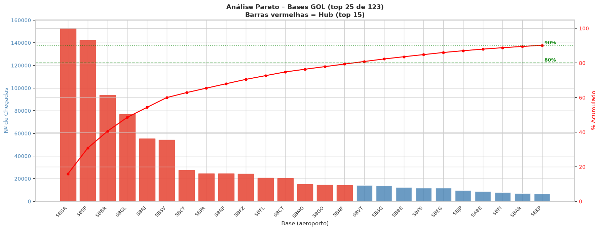
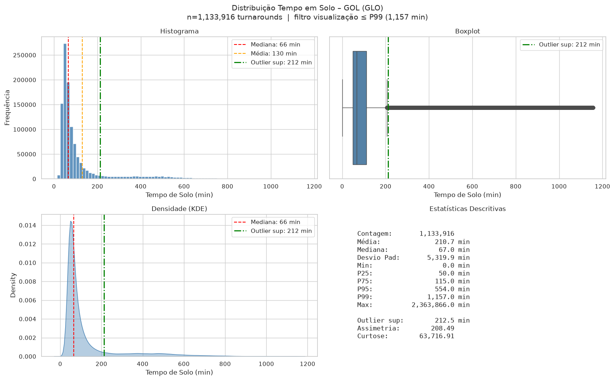
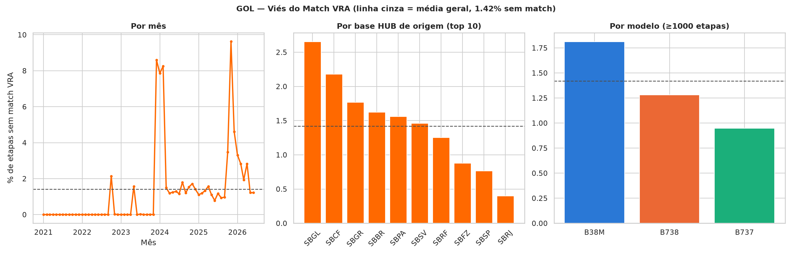

<!--
ORIENTAÇÃO — Métodos (Dados e Abordagem)
Guia metodológico, seção 2: fontes, premissas, escopo e limitações. É a seção
que torna o relatório auditável, a mais cortada sob prazo e a que mais falta
depois quando alguém questiona um achado.
-->

## Fontes de dados

Todo o material vem dos microdados públicos da ANAC, em duas bases distintas:

| Base | O que traz | Uso neste documento |
|---|---|---|
| Básica | Etapa de voo realizada: empresa, matrícula, modelo, origem, destino, horas voadas, data e hora de partida real | Destinos, frota, tempo de solo, etapa média |
| VRA | Voo regular ativo: horário previsto de partida e chegada, situação do voo | Block time (comparação entre previsto e realizado) |

As duas bases foram ingeridas em SQLite no projeto `learn-microdados_anac_dados`, em arquivos fisicamente separados. Sobre elas, três camadas: `trusted_essencial` (as 29 colunas essenciais, derivadas da camada silver), `curated_deep_dive_gol` e `curated_deep_dive_azul` (filtro por empresa e janela a partir de 2021-01-01), e duas tabelas de fato materializadas, `fato_rotacao_aeronave_gol_azul` (tempo de solo) e `fato_block_time_gol_azul` (junção Básica × VRA).

A frente manual de destinos e frota foi construída fora desse pipeline, sobre a mesma fonte pública, com tratamento próprio. Isso é uma diferença de método relevante e está tratada em Limitações.

## As perguntas de análise

São seis perguntas formais, que produzem os cinco indicadores citados na Introdução: a quarta (hub e off-hub) não é um indicador próprio, é a classificação de base usada para segmentar as demais. Todas foram fixadas antes do cálculo, de forma independente do motor de banco usado, e cada uma tem definição operacional própria.

**1. Destinos e malha.** Número de destinos distintos atendidos por dia, sua variação cíclica e a amplitude dessa variação ao longo do ano. Métrica complementar: quais bases entram e saem da oferta de forma recorrente. A leitura da periodicidade usa análise de frequência sobre a série diária de destinos distintos.

**2. Distribuição da frota.** Composição percentual da frota por modelo, ano a ano, e idade em serviço por matrícula. Idade em serviço é definida como o intervalo entre a primeira e a última aparição de uma matrícula na base, não como idade de fabricação da aeronave, que o dado público não traz.

**3. Comportamento do tempo de solo.** Turnaround real: intervalo entre a chegada de uma etapa e a partida da etapa seguinte da mesma matrícula, no mesmo aeroporto. Segmentado por modelo de aeronave e por base.

**4. Caracterização das bases (hub e off-hub).** Classificação de aeroporto por volume de chegadas, pela regra de Pareto: as bases que, somadas em ordem decrescente, acumulam 80% das chegadas são tratadas como hub; o restante, como off-hub. É uma classificação estatística construída aqui, não uma designação operacional declarada pela companhia.

**5. Etapa média.** Duração do voo (horas voadas registradas na Básica) como métrica principal, distância em quilômetros como métrica complementar e velocidade média inferida (distância dividida por duração) como métrica derivada. Segmentada por modelo, por base de origem e por natureza da linha (doméstica ou internacional).

**6. Block time (folga e atrasos).** Três variáveis, todas derivadas da junção Básica × VRA:

| Variável | Definição | Leitura |
|---|---|---|
| Folga | Tempo previsto (VRA) menos horas voadas (Básica) | Positiva é sobra de tempo programado; negativa é falta |
| Atraso de partida | Partida real menos partida prevista | Positivo saiu atrasado |
| Atraso de chegada | Chegada real menos chegada prevista | Positivo chegou atrasado |
| Delta de atraso em voo | Atraso de chegada menos atraso de partida | Negativo recuperou atraso durante o voo |

A folga não é margem estratégica pura nem tempo de taxi estrutural: é a soma das duas coisas, e o dado disponível não permite separá-las. A quarta variável foi criada porque atraso de partida e de chegada são quase redundantes entre si, com correlação de 0,976 na GOL e 0,970 na Azul: a diferença entre os dois é o conteúdo novo, não cada um isoladamente.

A chave de junção entre Básica e VRA é empresa (código ICAO), número de voo, data de partida, hora de partida e aeroporto de origem. A hora foi incorporada à chave após medição: sem ela, 6.392 grupos de chave duplicada em uma amostra de 2025; com ela, 13 grupos residuais.

## Premissas

1. **Só etapas de passageiro.** Cargueiro é excluído em toda a linha de análise. A exclusão não é herdada automaticamente pelas tabelas de fato e precisou ser aplicada explicitamente: 21.494 etapas de cargueiro na GOL (1,9%) e 22.884 na Azul (1,5%).
2. **Continuidade de rotação.** Tempo de solo só é considerado válido quando a etapa seguinte parte do mesmo aeroporto em que a anterior chegou. A taxa de continuidade medida na fonte é de 99,86%.
3. **Reconstrução do histórico de matrícula.** Os microdados não trazem a rotação da aeronave pronta: ela é reconstruída ordenando as etapas por matrícula e tempo. Lacunas na fonte produzem intervalos artificiais, tratados pelas regras de corte abaixo.
4. **Dois critérios de corte de outlier em tempo de solo, não um.** A frente manual usou 1,5 vezes o intervalo interquartil sobre a distribuição bruta, chegando ao limiar de 212,5 minutos (3h30). A frente reprodutível usou uma regra de validade aplicada no banco, antes de qualquer script: exclui valor negativo, continuidade quebrada e intervalo acima de 72 horas. Sobre o dado já filtrado, a cerca de Tukey fica em 3,542 horas na GOL e 3,767 horas na Azul, com 15,3% e 15,2% das etapas fora dela em cada companhia. Os dois critérios são declarados porque produzem números não diretamente comparáveis entre as duas frentes.
5. **Corte de exibição em block time.** Folga e atrasos usam corte fixo de 60 minutos para cada lado, em vez da cerca de Tukey, que variava de variável para variável. O corte é mais permissivo que Tukey para folga e mais restrito para atraso.
6. **Pernoite legítimo aparece como outlier estatístico.** Um intervalo de solo de fim de semana, dentro da regra de validade de 72 horas, cai fora da cerca de Tukey. Isso é a cerca sendo aplicada a uma distribuição estruturalmente bimodal (turnaround do mesmo dia contra pernoite), não erro de dado.

## Escopo

Dentro: as seis perguntas acima, para GOL e Azul, na janela de janeiro de 2021 em diante, só etapas de passageiro.

Fora, por decisão explícita:

- Decomposição do tempo de solo em componentes (taxi, portão, conexão). A fonte não tem granularidade para isso.
- Capacidade ofertada (assentos, ASK) na análise de rota e mercado, deliberadamente adiada.
- Teste estatístico formal de qualquer hipótese candidata registrada nos Resultados.
- Investigação de causa raiz das linhas com tempo de solo inválido (0,29% do total), já registrada como achado no documento da camada de dado.

## Limitações

**Assimetria entre as duas frentes.** Destinos e frota vêm da frente manual, que não tem script reprodutível nem trilha de método formalizada; tempo de solo, etapa média e block time vêm da frente reprodutível, com método e achados registrados. Uma divergência já medida ilustra o efeito: a classificação de bases hub produzida manualmente lista 15 bases, com Guarulhos à frente de Congonhas; a reprodutível lista 16 e coloca Congonhas em primeiro. As posições 3 a 12 são idênticas nas duas. A explicação mais provável, não confirmada por rastro documental direto, é que a versão manual é um instantâneo de um estágio anterior do pipeline.

**Hub é classificação estatística.** A regra de 80% acumulado é uma convenção adotada aqui. Uma base pode entrar ou sair da lista por variação de volume sem que nada tenha mudado operacionalmente: Vitória e Maceió trocam de lado dependendo da janela e do momento da extração.

**Cobertura desigual da Azul.** A Azul entra como contraponto completo em tempo de solo, etapa média e block time, mas em destinos aparece só na comparação de amplitude e periodicidade da malha, e em frota não aparece.

**Viés de pareamento com o VRA.** A proporção de etapas sem par no VRA salta de perto de zero, entre 2021 e 2023, para uma faixa mais alta a partir de janeiro de 2024: 1,42% no total da GOL, com pico mensal de 9,64%, e 1,15% na Azul, com pico de 3,47%. O salto aparece nas duas companhias, no mesmo mês, o que enfraquece a explicação por evento específico de uma delas e aponta para mudança de processo do lado do VRA. Não investigado a fundo.

**Autocorrelação medida sem o desvio padrão que a acompanha.** A autocorrelação de defasagem 1 foi calculada para a média diária de tempo de solo e de etapa média, mas o desvio padrão dessas séries não. Como a autocorrelação é normalizada pela variância, ela informa a fração da variação que persiste, não a quantidade de variação: os dois números só se interpretam em conjunto. Além disso, só a defasagem 1 foi calculada, sobre séries com sazonalidade semanal conhecida, e nenhuma correção foi feita para o número de etapas por dia, que difere entre as companhias. O valor medido também depende do corte de outlier aplicado à série, e os quatro coeficientes deste documento vêm de três regimes de limpeza distintos: a autocorrelação de tempo de solo é 0,613 na GOL e 0,805 na Azul sobre a cerca de Tukey de cada companhia, e 0,674 e 0,861 sobre corte fixo de 3,0 horas; a de etapa média, 0,429 e 0,731, vem da série sem corte algum. Coeficientes de regimes diferentes comparam-se pela ordenação, não pela magnitude, e qualquer rodada futura precisa fixar um corte único antes de comparar bases entre si. As consequências disso estão em Discussão, Incertezas.

**Janela mais curta em block time.** O VRA publica com atraso: o dado vai até 1º de julho de 2026, contra 1º de agosto na Básica. A janela de block time termina em 30 de junho de 2026, e por isso não é diretamente comparável às demais no trecho final da série.

**Timestamps corrompidos no VRA.** Atrasos acima de 24 horas em valor absoluto são erro de registro, não evento operacional. Foram removidos por filtro pontual: 71 e 95 linhas na GOL (partida e chegada), 113 e 138 na Azul, todas abaixo de 0,01% do total.
