<!--
ORIENTAÇÃO — Resultados (Achados)
Guia metodológico, seção 2: o que os dados mostram, com incerteza explícita.
Achado confirmado e hipótese candidata em prateleiras separadas. Sem
interpretação: o "por quê" é assunto da Discussão.
-->

## Achados confirmados

### Destinos e malha

O número de destinos distintos atendidos por dia varia de forma cíclica, com períodos típicos de 7, 3 e 2 dias. O ciclo de 7 dias domina, o que caracteriza uma malha construída sobre uma semana típica e repetida. A mesma leitura aplicada à Azul mostra uma distribuição de ciclos muito mais difusa.

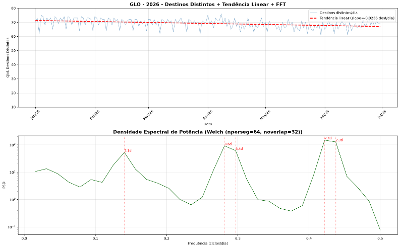

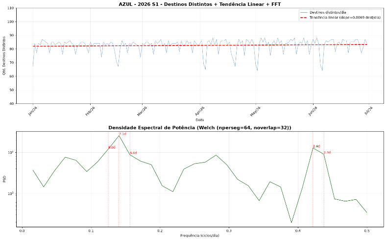

A amplitude absoluta da variação separa as duas companhias com mais clareza que o nível médio. Em 2025, a GOL oscilou entre extremos separados por 7 destinos, contra 25 da Azul. O número médio de destinos da GOL cresce de forma sustentada ao longo da série, de 46 em 2021 para 69 em 2026, enquanto a Azul cresce até 2023 e recua depois.

| Indicador | Empresa | 2021 | 2022 | 2023 | 2024 | 2025 | 2026 |
|---|---|---|---|---|---|---|---|
| Média de destinos | GOL | 46 | 57 | 63 | 65 | 68 | 69 |
| Média de destinos | Azul | 77 | 91 | 93 | 92 | 88 | 83 |
| Variação absoluta | GOL | 30 | 22 | 12 | 9 | 7 | 10 |
| Variação absoluta | Azul | 34 | 27 | 15 | 13 | 25 | 10 |
| Desvio padrão da variação | GOL | 1,3 | 1,4 | 1,3 | 1,0 | 0,5 | 0,7 |
| Desvio padrão da variação | Azul | 2,9 | 3,5 | 3,2 | 2,6 | 2,0 | 2,1 |

Tabela 1: médias de destinos distintos, variação absoluta e dispersão da variação, por ano. Valores de 2026 cobrem ano parcial.

A dispersão da variação da GOL cai de forma monotônica de 2021 a 2025 (1,3 para 0,5) e sobe levemente em 2026. A Azul mantém dispersão duas a quatro vezes maior em todos os anos da série.

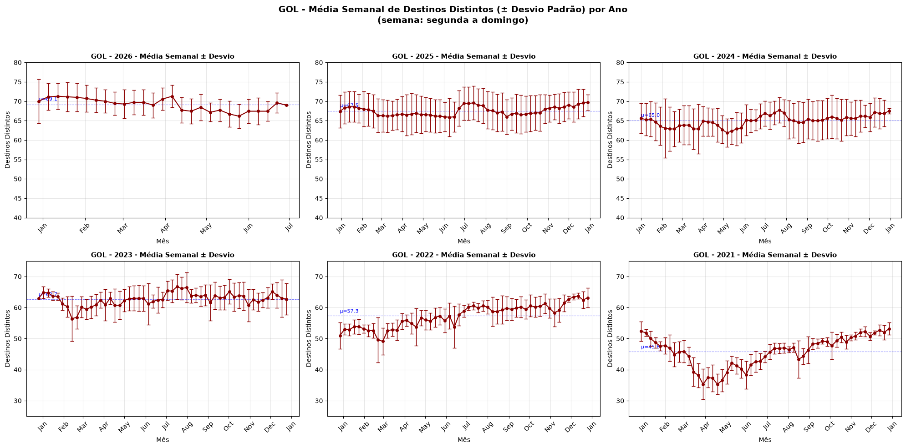

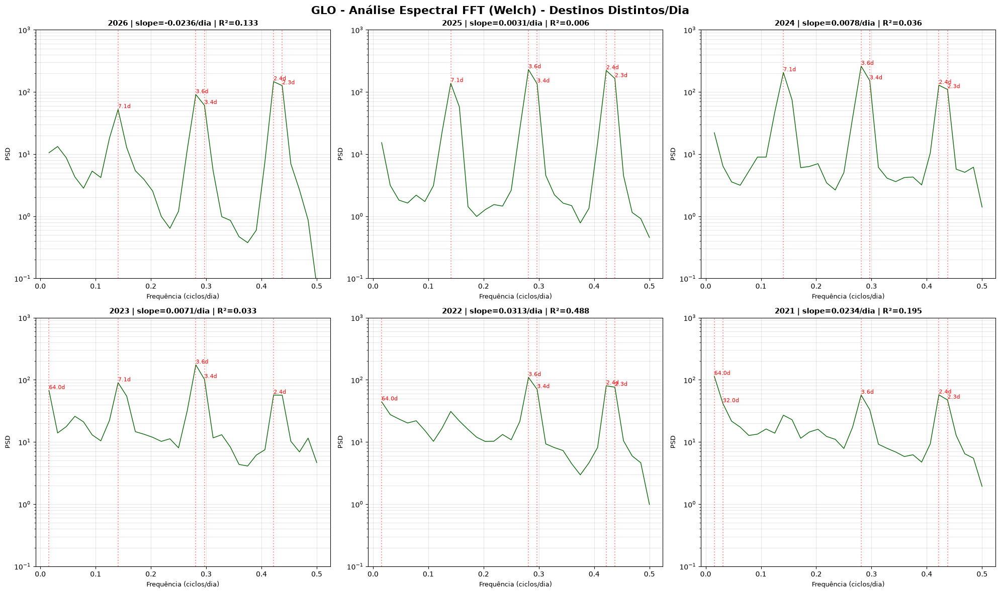

A uniformização das barras de variância em 2025 e 2026 é visível a olho e consistente com o desvio padrão da tabela. Isolando as bases que entram e saem da oferta ao longo do mês, chega-se a um conjunto pequeno e recorrente, todas de baixo volume.

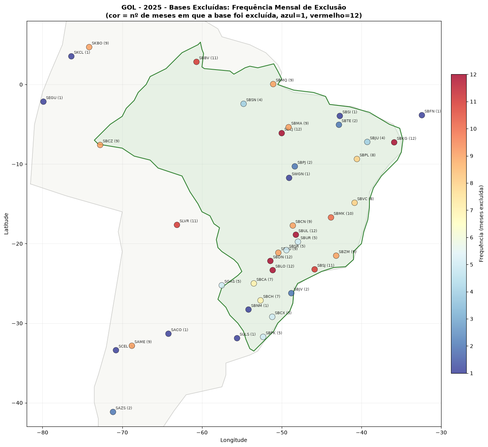

| IATA | ICAO | Aeroporto | Município | Ocorrências |
|---|---|---|---|---|
| CKS | SBCJ | Carajás | Parauapebas | 12 |
| PPB | SBDN | Presidente Prudente | Presidente Prudente | 12 |
| CPV | SBKG | Presidente João Suassuna | Campina Grande | 12 |
| LDB | SBLO | Governador José Richa | Londrina | 12 |
| UDI | SBUL | Ten. Cel. Av. César Bombonato | Uberlândia | 12 |
| SJK | SBSJ | Prof. Urbano Ernesto Stumpf | São José dos Campos | 11 |
| BVB | SBBV | Atlas Brasil Cantanhede | Boa Vista | 11 |
| VVI | SLVR | Viru Viru | Santa Cruz | 11 |
| MOC | SBMK | Mário Ribeiro | Montes Claros | 10 |

Tabela 2: bases preteridas de forma cíclica na oferta de destinos.

### Frota

A frota da GOL na janela analisada tem três modelos, todos Boeing: 737-800 (57%), 737 MAX 8 (31%) e 737-700 (12%). Nenhum modelo novo entrou na frota no período. A proporção entre eles muda de forma gradual, com o 737-800 cedendo participação ao MAX 8 ano a ano.

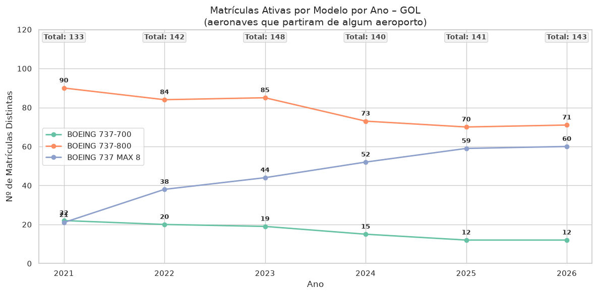

A entrada de matrículas novas não é contínua. O MAX 8 entrou de forma mais constante entre 2021 e 2022 e depois em dois blocos concentrados, no início de 2024 e no início de 2025. O 737-800 concentra entradas no começo da série.

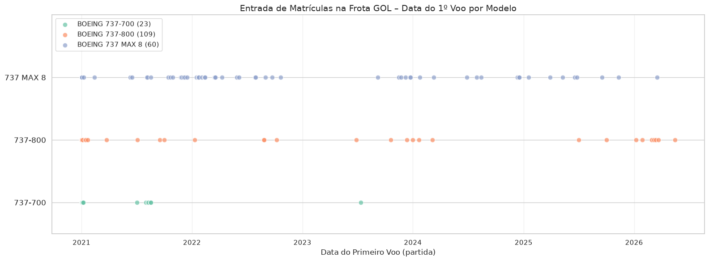

A idade em serviço, medida entre a primeira e a última aparição da matrícula, tem mediana em torno de 4 anos. Os modelos 737-800 e MAX 8 têm distribuição mais homogênea entre si; o 737-700 é o mais disperso.

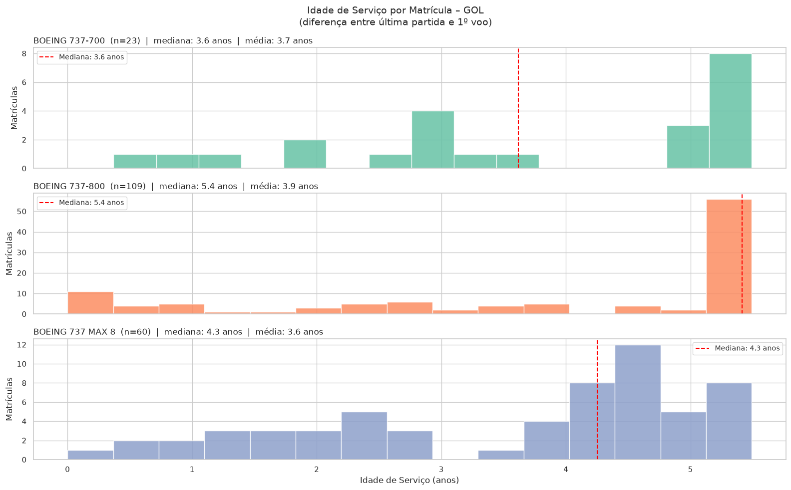

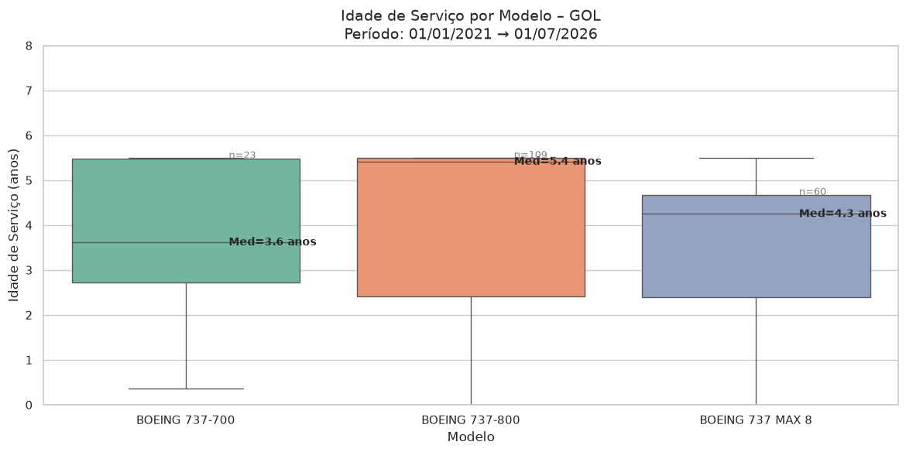

### Tempo de solo, hub e off-hub

A distribuição do tempo de solo tem cauda longa e é estruturalmente bimodal: uma massa concentrada em turnaround curto, do mesmo dia, e uma segunda massa de pernoite. Na frente reprodutível, mesmo depois de aplicada a regra de validade, a cerca de Tukey fica em 3,542 horas na GOL e 3,767 horas na Azul, deixando de fora 15,3% e 15,2% das etapas de cada companhia. O máximo observado encosta no teto de validade de 72 horas nas duas.

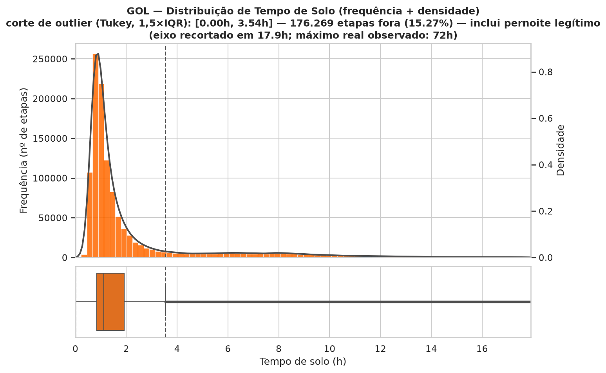

**As medianas de tempo de solo são praticamente iguais entre os três modelos de aeronave.** A variabilidade do tempo de solo não vem do equipamento. A maior parte das observações fica abaixo de 60 minutos.

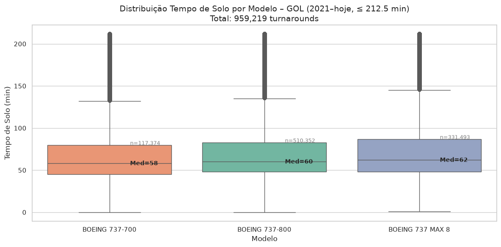

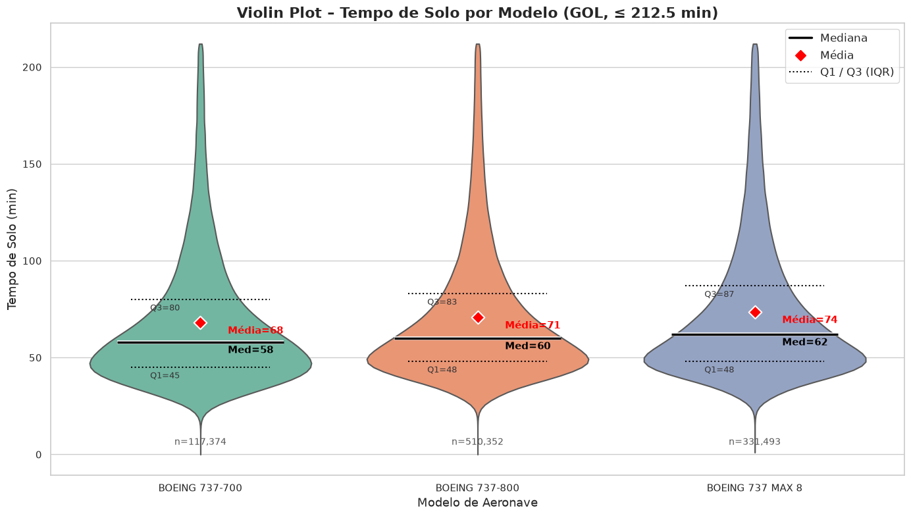

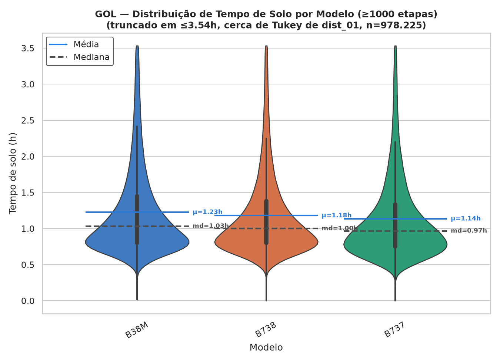

A variabilidade aparece quando se troca o eixo de segmentação de modelo para base. Aplicada a regra de Pareto sobre as chegadas, as bases hub da GOL são lideradas por Guarulhos, Congonhas, Brasília, Galeão e Santos Dumont; as da Azul, por Viracopos, Confins, Recife, Santos Dumont e Congonhas. A composição diferente é esperada e reflete a malha própria de cada companhia.

Nos dez maiores hubs da GOL não há tendência consistente de alta ou de queda ao longo dos três últimos anos. Há, porém, uma quebra específica: **os sete principais hubs registraram aumento do tempo médio de solo entre 2025 e 2026.**

| IATA | ICAO | Rank 2026 | Mediana 2024 | Mediana 2025 | Mediana 2026 | Média 2024 | Média 2025 | Média 2026 |
|---|---|---|---|---|---|---|---|---|
| CGH | SBSP | 1 | 71 | 71 | 72 | 79 | 79 | 80 |
| GRU | SBGR | 2 | 80 | 80 | 86 | 88 | 89 | 94 |
| GIG | SBGL | 3 | 62 | 65 | 70 | 73 | 75 | 82 |
| BSB | SBBR | 4 | 71 | 72 | 79 | 81 | 82 | 88 |
| SSA | SBSV | 5 | 54 | 57 | 60 | 64 | 67 | 69 |
| SDU | SBRJ | 6 | 50 | 52 | 56 | 54 | 56 | 62 |
| CNF | SBCF | 7 | 51 | 54 | 58 | 62 | 63 | 70 |
| REC | SBRF | 8 | 51 | 54 | 54 | 66 | 72 | 70 |
| FLN | SBFL | 9 | 48 | 49 | 49 | 55 | 55 | 56 |
| POA | SBPA | 10 | 49 | 49 | 52 | 56 | 55 | 61 |

Tabela 3: tempo de solo em minutos nos dez hubs com mais chegadas, GOL. Valores de 2026 cobrem ano parcial.

Os sete primeiros sobem na média entre 2025 e 2026, com aumentos que vão de 1 minuto em Congonhas a 7 minutos em Galeão e 6 em Brasília e Santos Dumont. Recife, oitavo, é o único que recua. A leitura por mediana acompanha a leitura por média em todos os casos, o que indica deslocamento do corpo da distribuição, não efeito de cauda.

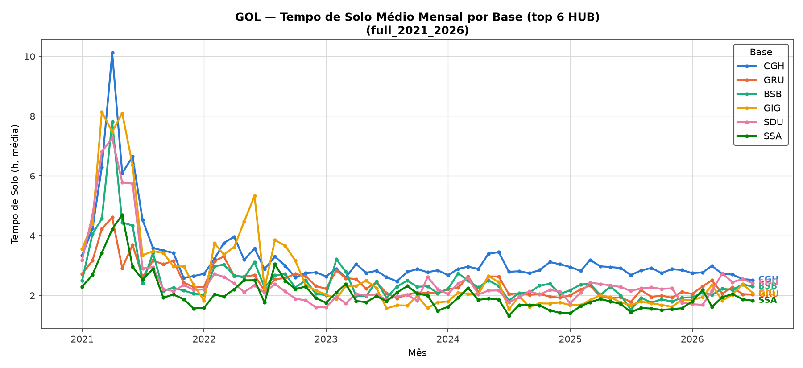

Na comparação direta com a Azul, a dispersão entre hubs é o eixo em que as duas companhias mais se parecem, e a memória da série diária é o eixo em que mais se distinguem: a autocorrelação da média diária de tempo de solo com o dia anterior é de 0,613 na GOL e 0,805 na Azul. A autocorrelação mede a fração da variação diária que persiste de um dia para o outro, não a quantidade de variação; o desvio padrão das duas séries diárias não foi calculado nesta rodada.

A Figura 17, abaixo, traz 0,674 na GOL e 0,861 na Azul: são os mesmos coeficientes calculados sobre um corte diferente. O texto usa a série truncada pela cerca de Tukey de cada companhia (Métodos, premissa 4); a figura vem do script comparativo, que aplica corte fixo de 3,0 horas às duas para manter os doze gráficos do confronto na mesma escala. O corte mais apertado eleva a autocorrelação medida nas duas empresas e não altera a ordenação entre elas.

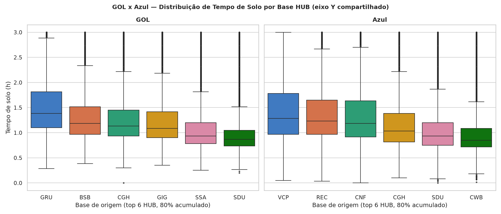

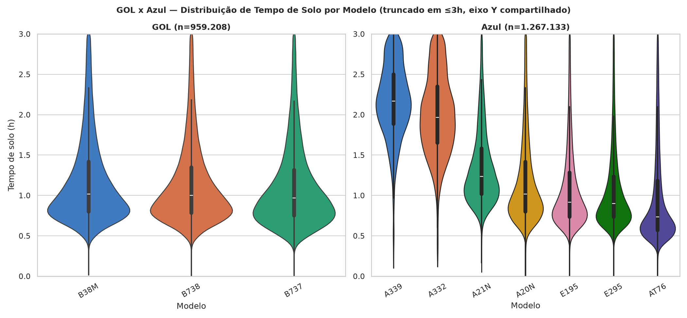

### Etapa média

A duração média de etapa da GOL fica em torno de 2 horas em toda a janela. A distribuição é mais concentrada que a de tempo de solo: a cerca de Tukey deixa de fora 1,45% das etapas na GOL, contra 3,70% na Azul, sobre 1.156.949 e 1.541.677 etapas de passageiro respectivamente.

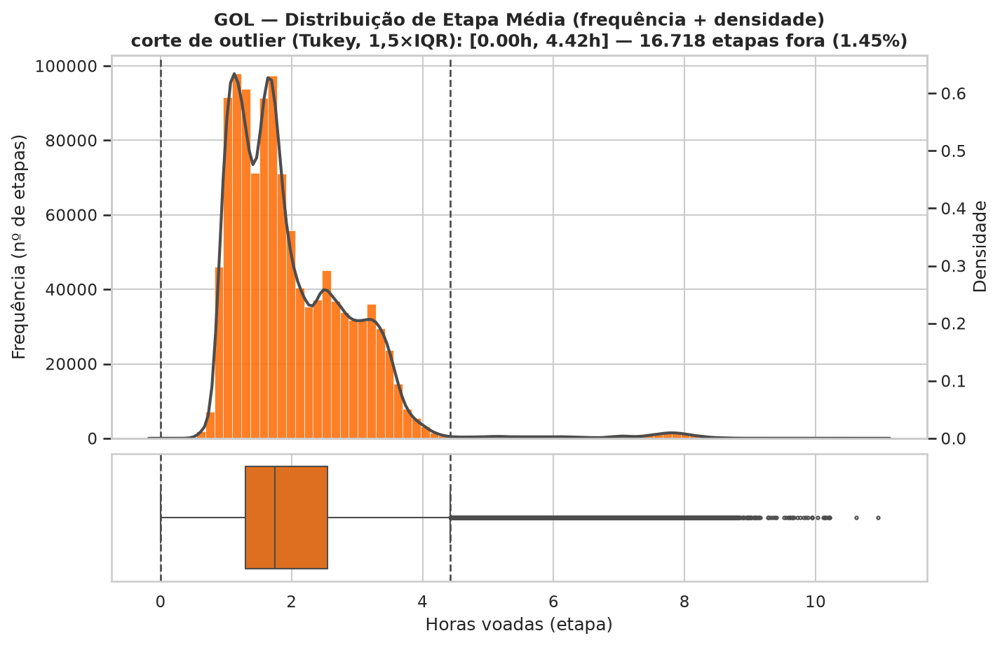

A série mensal mostra sazonalidade recorrente, com pico em torno de janeiro e vale entre abril e junho, presente em todos os anos completos da série. A amplitude do pico cresce: janeiro de 2021 em torno de 2,07 horas, janeiro de 2025 em torno de 2,15 horas, o maior da série. O recorte de 2026 repete o padrão, com 2,12 horas em janeiro, vale de 1,95 hora em maio e retomada até 2,09 horas em julho. A sazonalidade sobrevive a todos os recortes de janela testados, inclusive os mais curtos, o que descarta artefato de série longa.

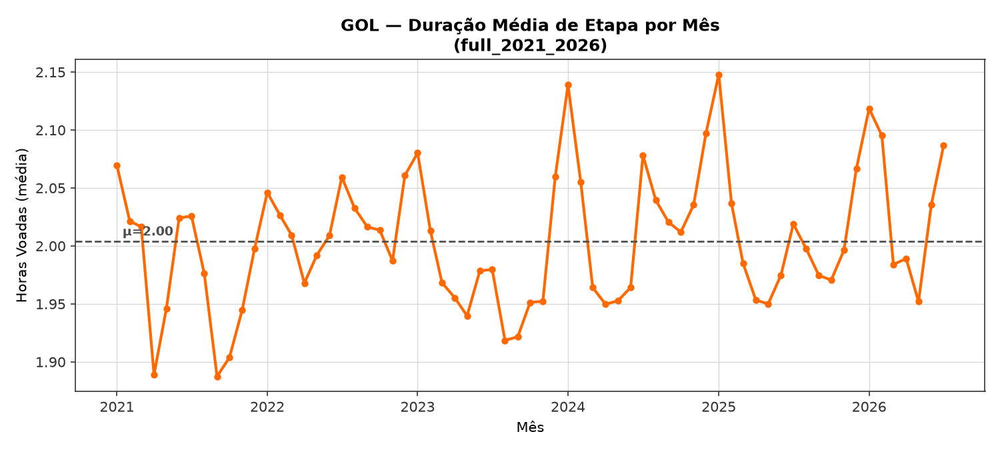

A ordenação entre modelos é estável: MAX 8 opera as etapas mais longas, seguido pelo 737-800 e pelo 737-700, tanto na malha doméstica quanto na internacional, em todas as janelas testadas. A razão entre internacional e doméstica é consistente entre modelos, em torno de 2,0 a 2,1 vezes, o que indica que nenhum modelo isolado distorce a leitura.

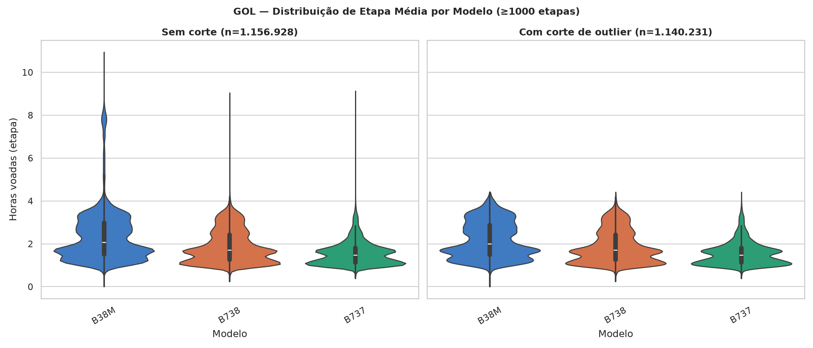

As três séries mensais por modelo nunca se cruzam em todo o período: a ordenação de nível se mantém mês a mês, não apenas na média agregada. O 737-700 é a série mais ruidosa e a única com viés de queda visível, de cerca de 1,9 hora em 2021 para 1,3 a 1,5 hora em 2026. No mesmo sentido, o 737-700 registra apenas 4 etapas internacionais em 2026, contra 830 no período completo.

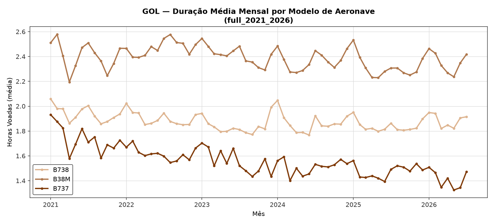

Por base de origem, volume e duração são eixos independentes. Congonhas e Guarulhos concentram volume (cerca de 175 mil e 173 mil etapas no período, contra 107 mil de Brasília), mas as maiores durações médias estão em Fortaleza e Recife, acima de 2,75 horas, com volume bem menor, entre 28 e 30 mil etapas.

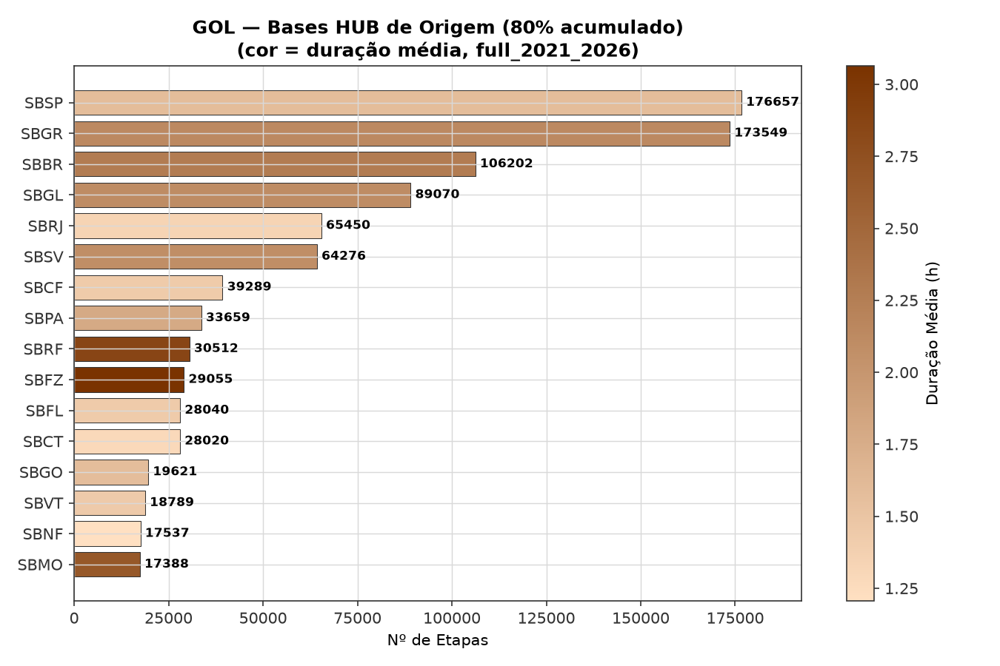

A série mensal por base revela dois movimentos de nível que os agregados escondem. O Galeão tem um platô isolado entre 2022 e meados de 2023, em torno de 2,6 a 2,7 horas, contra 2,1 a 2,3 horas no seu próprio nível antes e depois. Santos Dumont tem uma quebra abrupta no fim de 2023, de 1,4 a 1,5 hora para 1,2 a 1,3 hora, que se mantém até o fim da série. A quebra de Santos Dumont não é gradual: muda de patamar em um único mês.

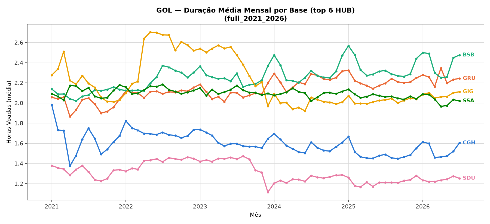

Na comparação com a Azul, a etapa média separa as duas companhias mais pelo perfil de frota que pelo nível. A memória da série diária repete o padrão já visto em tempo de solo: autocorrelação de defasagem 1 de 0,429 na GOL contra 0,731 na Azul. Os dois indicadores ordenam as companhias no mesmo sentido, o que indica propriedade consistente das séries; não distingue, porém, causa operacional de causa mecânica, já que os fatores de confusão candidatos afetariam os dois indicadores igualmente.

Uma diferença de tratamento separa os dois indicadores e precisa ser declarada antes de comparar suas magnitudes. A série diária de etapa média é construída sem corte de outlier, ao contrário da de tempo de solo, que chega truncada pela cerca de Tukey de cada companhia. Os coeficientes das duas linhas vêm, portanto, de regimes de limpeza diferentes. O que se compara com segurança é a ordenação entre companhias, que se repete nas duas; a diferença de magnitude entre 0,429 e 0,613 não é atribuível só ao indicador, porque o corte também mudou.

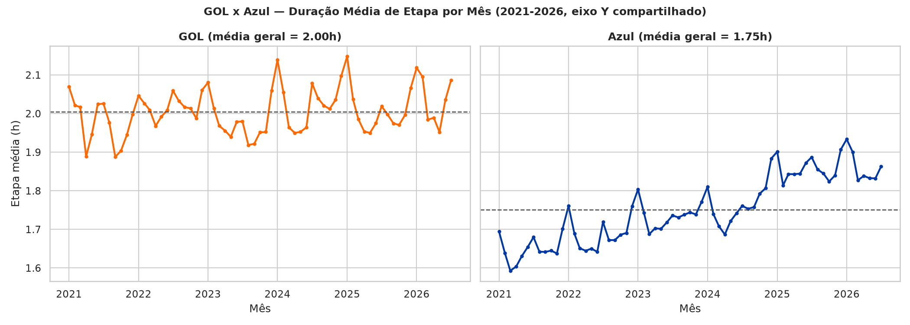

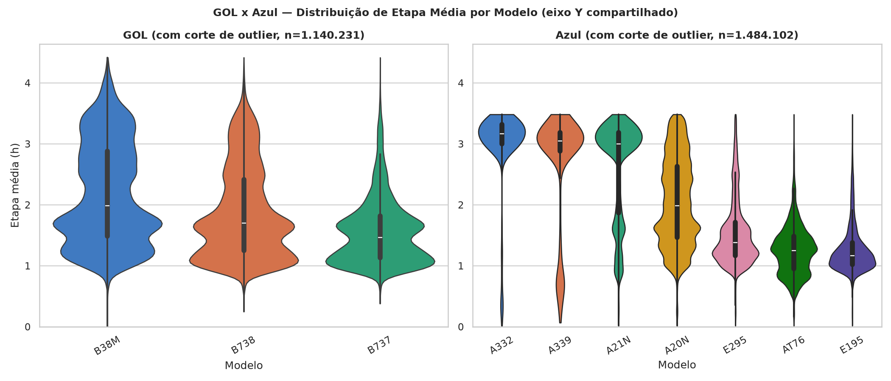

### Block time: folga e atrasos

A folga, diferença entre o tempo previsto no VRA e as horas efetivamente voadas, se distribui em torno de um valor central estreito, com granularidade de minuto inteiro na fonte.

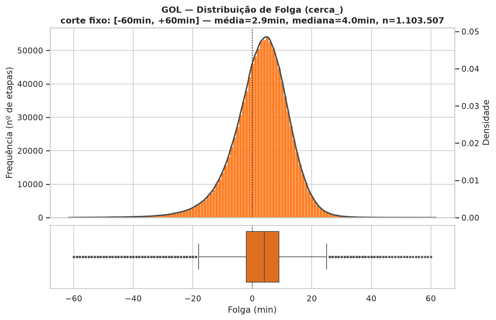

Segmentada por modelo, a folga acompanha o padrão já visto em tempo de solo: não é o equipamento que produz a variação relevante.

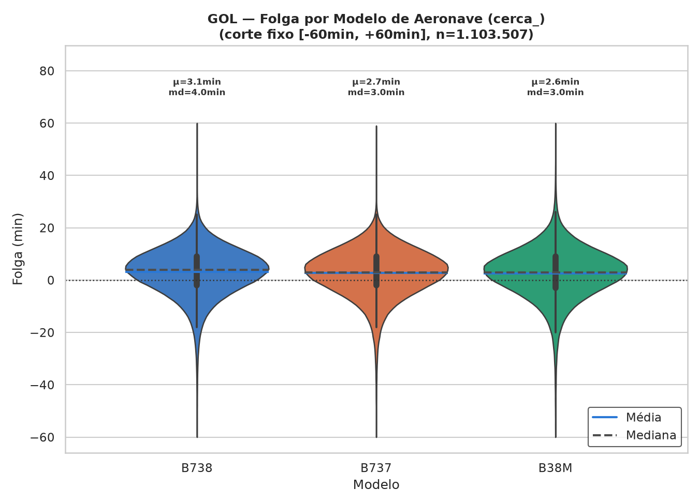

Segmentada por hub, a folga ordena as bases no mesmo sentido em que o tempo de solo as ordena, mas com separação muito menor: as medianas ficam entre cerca de 5 e 2 minutos, e as caixas se sobrepõem quase inteiramente. O eixo é o mesmo; a magnitude não é comparável.

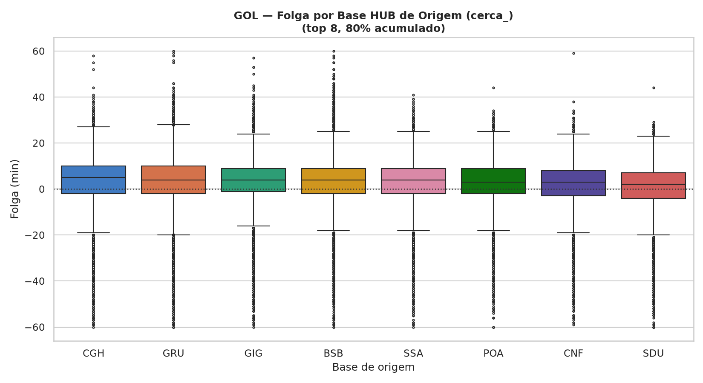

Atraso de partida e atraso de chegada carregam quase a mesma informação, com correlação de 0,976 na GOL e 0,970 na Azul. O conteúdo novo está na diferença entre os dois. **Em mediana, as duas companhias recuperam atraso durante o voo**: 4,0 minutos na GOL e 3,0 minutos na Azul; em média, 2,8 e 2,2 minutos.

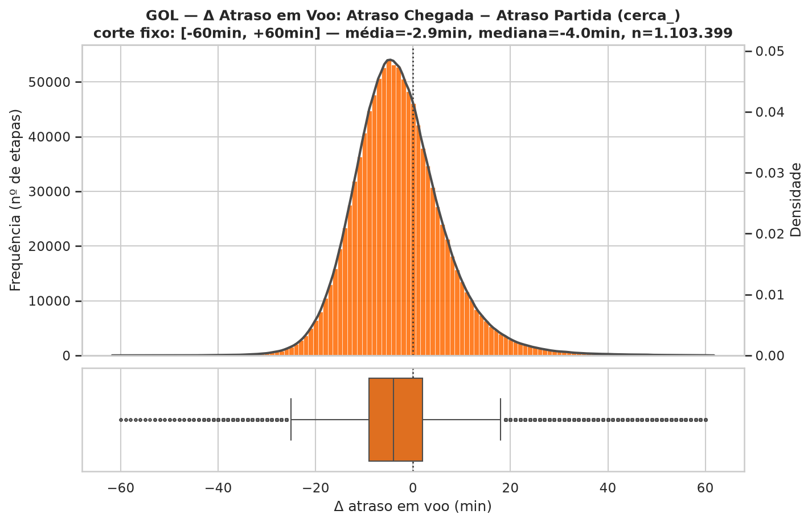

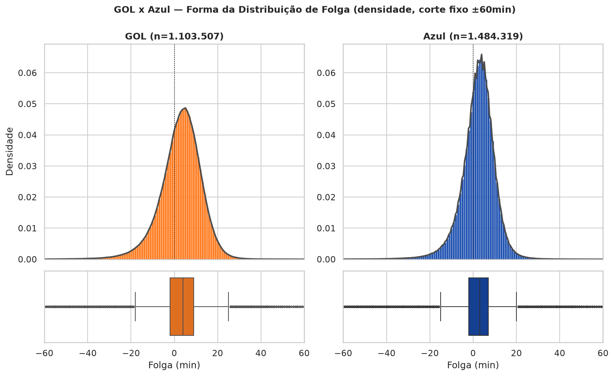

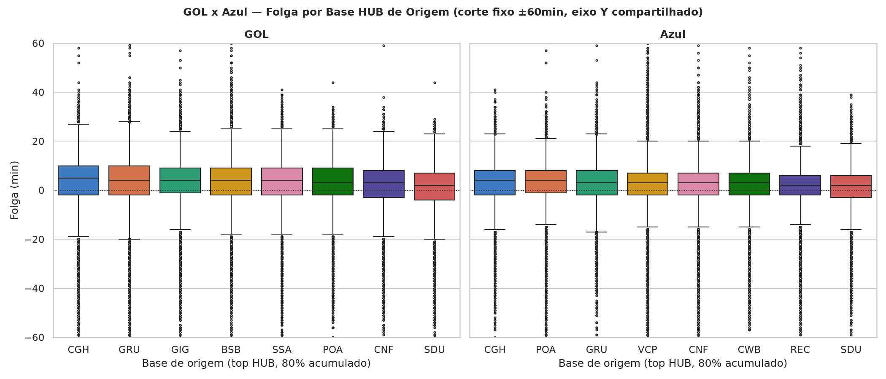

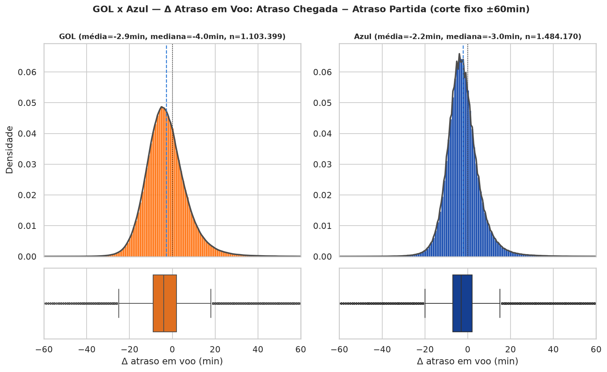

## Hipóteses candidatas

As afirmações abaixo têm evidência sugestiva e insuficiente para inferência forte. Nenhuma foi testada.

1. **A homogeneidade da malha da GOL é escolha estratégica, não restrição estrutural.** O dado mostra o padrão (ciclos regulares, amplitude baixa, dispersão caindo ano a ano), não a intenção por trás dele. Uma restrição de frota, de slot ou de estrutura de rede produziria o mesmo padrão observável.
2. **A transição de 737-800 para MAX 8 responde a pressão competitiva por eficiência.** A substituição ordenada está medida; a motivação não. O documento observa o padrão de troca, não testa a causa.
3. **Modelos mais modernos são alocados deliberadamente em etapas mais longas.** A ordenação MAX 8 acima do 737-800 acima do 737-700 é estável e sobrevive ao corte por natureza da linha, o que é consistente com alocação deliberada, mas também com pura diferença de alcance dos equipamentos.
4. **A saída do 737-700 do internacional é decisão de rede.** Quatro etapas internacionais em 2026 contra 830 no período completo confirmam o fato; a leitura de que é decisão de rede, e não realocação de frota, não foi verificada.
5. **O platô do Galeão em 2022 e 2023 vem de malha internacional temporária operada dali.** Movimento isolado, sem equivalente em nenhuma outra base do grupo, não investigado.
6. **A quebra de nível de Santos Dumont no fim de 2023 vem de mudança de mix de rotas.** Consistente com o perfil de ponte aérea da base, não verificado.
7. **O aumento de tempo de solo nos sete principais hubs entre 2025 e 2026 tem causa operacional local.** Candidatos plausíveis: processo em solo, restrição de infraestrutura, congestionamento. Nenhum testado. Esta é a hipótese com maior consequência prática do conjunto.
8. **Os vales profundos de 2021 na etapa média refletem malha internacional reduzida no início da retomada.** Dois vales em torno de 1,89 hora, em fevereiro e julho de 2021, bem abaixo dos anos seguintes.

Uma hipótese foi levantada e **refutada** no curso da análise: a de que o viés de pareamento com o VRA a partir de 2024 estaria ligado a evento específico da GOL. O mesmo salto, no mesmo mês, aparece na Azul, que não passou pelo evento em questão. A refutação não substitui a hipótese por outra confirmada: a explicação mais consistente, mudança de processo do lado do VRA, permanece não verificada.
