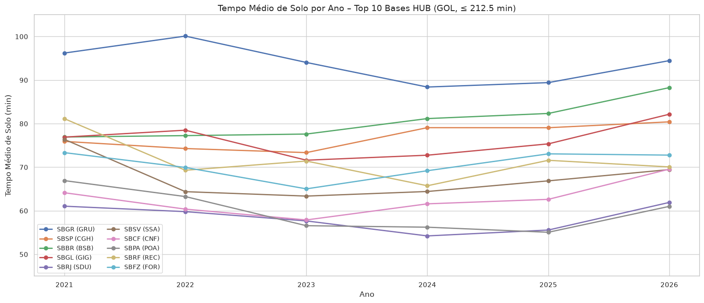

<!--
ORIENTAÇÃO — Recomendação (governing thought)
A resposta direta, no primeiro parágrafo. É a única seção que o gestor pode ler
sozinha e ainda assim saber o que fazer. Responde à QUESTÃO formulada no fim da
seção Situação, e nenhuma outra.

Três testes antes de dar por pronta:
1. Um leitor que parar aqui sabe o que precisa decidir? Se não, ainda é resumo.
2. A frase é uma AFIRMAÇÃO ou uma AÇÃO? Minto pede a segunda. "A GOL opera um
   modelo homogêneo" é achado, não recomendação.
3. Se a análise concluir "depende", NÃO force recomendação: diga qual é a
   decisão pendente e mande o leitor para a seção de critério (guia
   metodológico, seção 5). Falso conforto é pior que ambiguidade declarada.

Teste adicional, porque este documento é dedutivo: a ação escrita aqui tem de
ser exatamente a conclusão do terceiro porquê. Se as duas frases não puderem
ser lidas como a mesma coisa, a cadeia não fecha e uma das duas está errada.

Convenção deste documento: uma figura aqui, a que mostra o problema de que a
recomendação trata. É a primeira coisa que o gestor olha depois da frase de
abertura, e deve sustentar a decisão sozinha.
-->

**Antes de mobilizar equipe operacional nos hubs, rode o cálculo de autocorrelação do tempo de solo por base.** É uma rodada de scripts que já existem, sobre dado já carregado, sem coleta nova e sem envolver as bases.

O aumento observado nos sete maiores hubs tem duas causas possíveis que pedem respostas opostas: restrição de capacidade, que é custo imposto de fora, ou mudança de processo em solo, que é escolha nossa. O dado atual não distingue as duas, e a autocorrelação distingue: ela mede quanto tempo um distúrbio leva para se dissipar em cada base, e um hub que carrega o atraso de um dia para o outro não tem folga para absorvê-lo, que é a assinatura esperada de restrição de capacidade.

