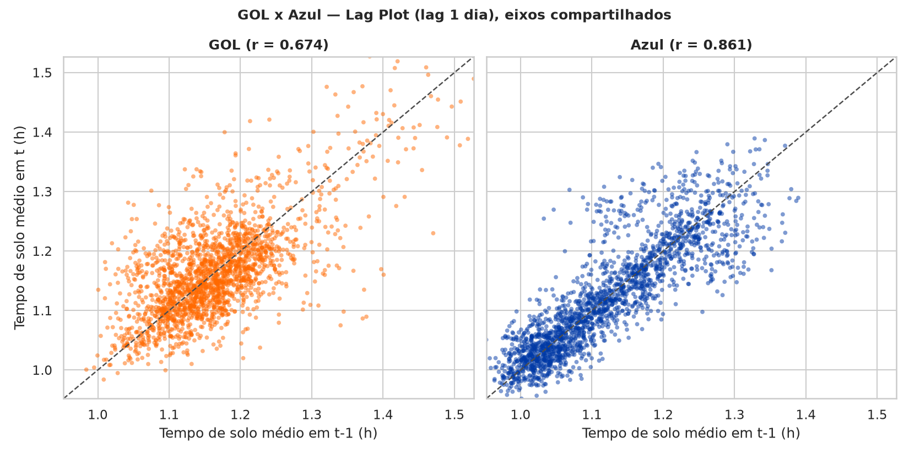

<!--
ORIENTAÇÃO — Porquês, em estrutura DEDUTIVA
Cada porquê é um "### Título" (o gerador conta os ### para validar a faixa
definida em config.yml, chave "porques"). Neste documento a faixa está travada
em exatamente 3, e o motivo está abaixo.

O QUE MUDA EM RELAÇÃO AO MODO INDUTIVO
Minto admite duas formas de sustentar a ideia governante:

- INDUTIVO: um grupo de razões da mesma espécie, que somam. "Faça X" apoiado
  por três razões independentes. É o modo que Minto prefere no topo, porque o
  leitor não precisa carregar nada de um item para o outro, e porque uma razão
  derrubada não leva as outras junto.
- DEDUTIVO: uma cadeia. Premissa maior (o que existe no mundo), premissa menor
  (um comentário sobre o sujeito ou o predicado da primeira), e o significado
  implicado pelas duas. Cada elo depende do anterior.

Este documento é DEDUTIVO, por decisão do autor. O motivo é o casamento com a
ideia governante: a Recomendação é uma AÇÃO ("rode o teste antes de mobilizar
equipe"), e a pergunta que ela levanta no leitor é "por que antes?". Uma lista
de achados responde a outra pergunta ("por que acreditar que há um problema?")
e deixa a ordem das providências sem sustentação. A cadeia responde à pergunta
certa porque termina exatamente na ação pedida.

REGRA DE ESCRITA DA CADEIA
- O porquê 3 tem de ser o resumo vertical dos dois anteriores. Teste: leia só
  os títulos 1 e 2 e pergunte "e daí?". Se a resposta não for o título 3, ou o
  elo está no lugar errado ou o título 3 está mal escrito.
- Cada elo abre com a conexão explícita ao anterior. Sem o conectivo, a cadeia
  vira lista e o leitor perde o fio.
- Nenhum quarto elo. Um quarto porquê não existe em dedução: ou ele é evidência
  dentro de um dos três, ou o argumento voltou a ser indutivo, e nesse caso
  esta orientação e a chave "porques" do config.yml precisam ser reescritas
  antes de escrever o texto.

O QUE SE PERDE, DITO NA CARA
As razões deixam de ser independentes. Se o leitor rejeitar o porquê 1, os
outros dois caem junto, o que não aconteceria num grupo indutivo. Além disso,
a dedução obriga o leitor a carregar as premissas até o fim. É por isso que os
três elos precisam ser curtos: a cadeia só compensa enquanto couber na cabeça
de quem lê uma vez só.

COBERTURA DOS CINCO INDICADORES
A poda vem do IMRaD, que analisa cinco indicadores (destinos, frota, tempo de
solo, etapa média, block time). No modo indutivo eles viravam um porquê cada,
o que organizava a pirâmide pela estrutura da coleta em vez da do argumento.
Aqui eles entram como EVIDÊNCIA dentro dos elos: destinos e frota estabelecem
o pano de fundo homogêneo no elo 1; etapa média e block time localizam a
variação no eixo da base no elo 2; tempo de solo atravessa os três. Os cinco
continuam presentes, sem mandar na estrutura.

Convenções deste documento, decididas pelo autor:
- O texto é AUTOCONSISTENTE. Não remete o leitor a seções do relatório IMRaD:
  cada elo carrega o número que o sustenta dentro do próprio parágrafo. A peça
  precisa funcionar sozinha, para quem nunca vai abrir o relatório.
- CADA elo traz pelo menos uma figura, e nenhuma figura entra sem carregar
  argumento. A pergunta antes de inserir é "que frase do parágrafo esta figura
  prova?". Se não houver resposta curta, a figura é ilustração e não entra.
- NADA de boxplot nem de violin plot. Eles descrevem a forma de uma
  distribuição, que é pergunta de relatório; aqui a pergunta é sempre
  comparativa ou temporal, e a resposta é série ao longo do tempo, ranking ou
  dispersão de pontos. Um gestor não lê quartil de passagem, e uma caixa lida
  errado atrasa a decisão em vez de acelerá-la. O caso concreto: a figura de
  folga por hub que estava aqui mostrava oito caixas quase idênticas, ou seja,
  contradizia a legenda que a acompanhava.
- Quando duas figuras formam um contraste (por base contra por modelo), elas
  vêm coladas, com a frase que instrui a comparação antes das duas, e devem
  compartilhar métrica, período e escala. Contraste em escalas diferentes não
  é contraste.
-->

O argumento abaixo é uma cadeia de três passos, não uma lista de três razões. Cada passo depende do anterior, e o terceiro é a recomendação.

### 1. Um sistema construído para se repetir teve, num único ponto, um desvio simultâneo

A operação da GOL é homogênea por desenho, e isso é medido, não impressão. A malha tem ciclo dominante de 7 dias, e a amplitude da variação semanal de destinos cai de 30 em 2021 para 7 em 2025, com a dispersão caindo junto (desvio padrão da variação de 1,3 para 0,5); a Azul, no mesmo 2025, opera com amplitude de 25. A frota tem três modelos, todos Boeing, em transição ordenada do 737-800 para o MAX 8, com idade em serviço mediana em torno de 4 anos e medianas de tempo de solo praticamente iguais entre os três.

Dentro desse sistema, os sete maiores hubs (Congonhas, Guarulhos, Galeão, Brasília, Salvador, Santos Dumont e Confins) subiram o tempo médio de solo entre 2025 e 2026, de 1 a 7 minutos, com a mediana acompanhando a média em todos os casos. Mediana acompanhando significa deslocamento do corpo da distribuição, não alguns eventos extremos puxando o número. Recife, o oitavo, é o único que recua. Nos três anos anteriores não há tendência consistente de alta nem de queda: o movimento de 2025 para 2026 é a única quebra de padrão do período.

Num sistema desenhado para se repetir semana após semana, um desvio simultâneo em sete bases é menos provável de ser ruído do que seria numa malha difusa. É essa homogeneidade que dá peso ao sinal.

### 2. Esse desvio vive no eixo da base, onde duas causas com respostas opostas competem

O desvio do passo 1 não está distribuído ao acaso pela operação: ele tem um eixo, e o eixo é a base, não o equipamento. Os outros dois indicadores operacionais dizem a mesma coisa. Na etapa média, as três séries mensais por modelo nunca se cruzam em cinco anos e meio, enquanto por base aparecem quebras isoladas e permanentes: o Galeão tem um platô entre 2022 e meados de 2023, em torno de 2,6 a 2,7 horas contra 2,1 a 2,3 antes e depois; Santos Dumont muda de patamar num único mês no fim de 2023, de 1,4 para 1,2 hora, e não volta. No block time vale a mesma leitura, em magnitude menor: a folga entre o tempo previsto e o voado não se separa por modelo de aeronave, e por base a mediana vai de cerca de 5 minutos em Congonhas a 2 em Santos Dumont, uma ordenação modesta mas consistente. As duas companhias ainda recuperam atraso em voo (mediana de 4 minutos na GOL, 3 na Azul), o que confirma que existe margem operacional em uso, administrada base a base.

Localizado o eixo, aparece o problema de decisão. No eixo da base, duas causas explicam igualmente bem um aumento de tempo de solo, e pedem respostas opostas: **restrição de capacidade** no aeroporto, que é custo imposto de fora e exige renegociar slots e reprogramar malha, ou **mudança de processo em solo**, que é escolha nossa, possivelmente absorção deliberada de folga para proteger a pontualidade da etapa seguinte, e cuja leitura correta seria a inversa. O dado atual não distingue as duas.

As duas figuras abaixo são o argumento inteiro deste passo, e devem ser lidas uma contra a outra: mesma métrica, mesmo período, mesma escala. Por base, o nível quebra e não volta. Por modelo de aeronave, as três séries correm paralelas do começo ao fim.

### 3. Existe um cálculo que separa as duas causas sem sair do dado atual, e ele é mais barato que qualquer ação

Como as duas causas do passo 2 pedem respostas opostas, agir antes de distinguir significa escolher uma delas no escuro, com metade de chance de mobilizar equipe operacional contra um custo que não é nosso, ou de renegociar infraestrutura contra um processo interno já conhecido. E existe um cálculo que separa as duas com o dado que já está carregado.

A autocorrelação mede quanto o tempo de solo de um dia é herdado do dia anterior, ou seja, quanto tempo um distúrbio leva para se dissipar. Um hub que carrega o atraso de um dia para o outro não tem folga para absorver distúrbio, que é a assinatura esperada de restrição de capacidade. Um hub que recupera no mesmo dia tem folga, e um aumento de nível ali é mais compatível com mudança de processo. O cálculo já foi feito para a companhia inteira, e a leitura funciona: a GOL dissipa distúrbio mais rápido que a Azul, num contraste visível a olho. **Falta rodá-lo por base, que é onde o passo 2 mostrou que a decisão vive.** São scripts que já existem, sobre dado já carregado, sem envolver as bases.

